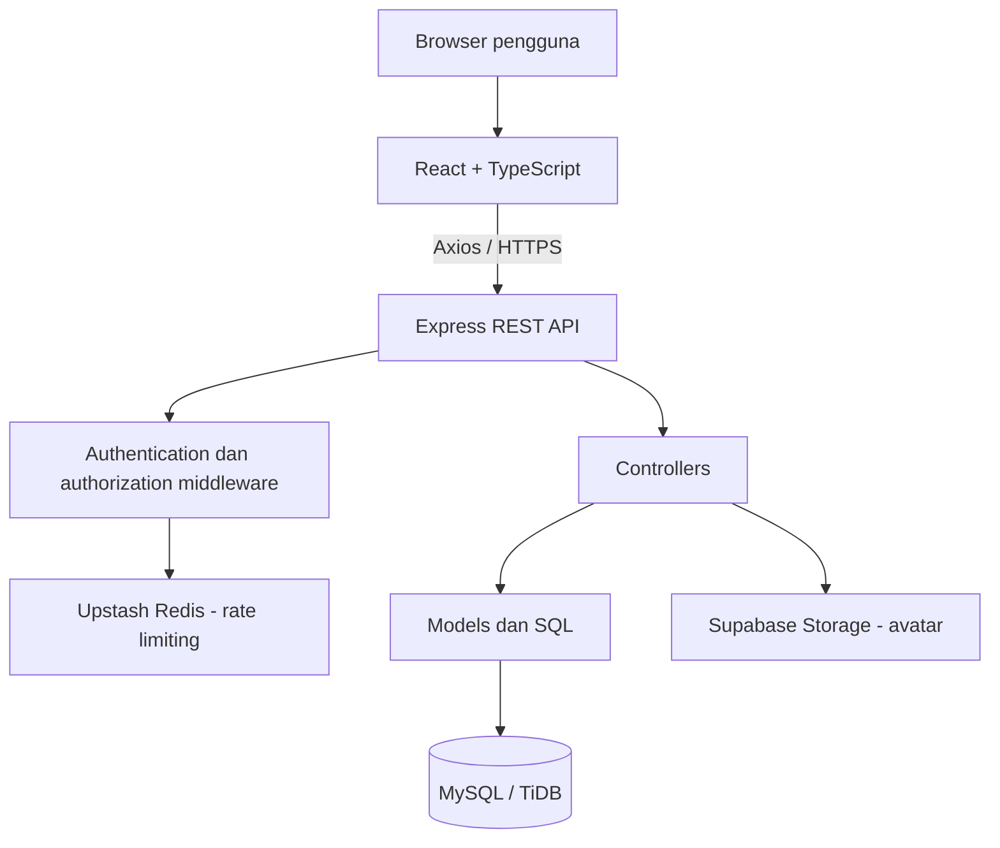

# CHILL — Movie & Series Streaming Platform

CHILL adalah aplikasi web streaming film dan serial berbasis full-stack JavaScript/TypeScript. Aplikasi ini menyediakan katalog, pemutar video, daftar tontonan pribadi, riwayat pemutaran, pengelolaan akun, dan pengelolaan konten oleh administrator.

    

## Daftar isi

- [Fitur](#fitur)
- [Teknologi](#teknologi)
- [Arsitektur](#arsitektur)
- [Instalasi lokal](#instalasi-lokal)
- [Environment variables](#environment-variables)
- [Database](#database)
- [API](#api)
- [Keamanan](#keamanan)
- [Deployment](#deployment)
- [Pengujian](#pengujian)
- [Roadmap](#roadmap)

## Fitur

### Pengguna

- Registrasi dan login menggunakan JWT.
- Single Device Login: sesi sebelumnya tidak berlaku setelah login baru.
- Katalog film dan serial, genre, rating, rekomendasi, dan kategori Top 10.
- My List untuk menyimpan dan menghapus konten favorit.
- Pemutar video film dan episode serial.
- Watch History dan Continue Watching untuk melanjutkan tontonan.
- Pengelolaan profil, perubahan password, dan upload avatar.
- Sistem paket subscription Individual dan simulasi pembayaran untuk lingkungan pengujian.

### Administrator

- Hak akses berbasis role (`admin` dan `user`).
- Penambahan, pembaruan, dan penghapusan film serta serial melalui API terproteksi.
- Pengelolaan metadata katalog, genre, episode, rekomendasi, dan status premium.

### Dalam pengembangan

- Premium Video Player berdasarkan desain Figma.
- Validasi akses pemutaran konten premium di backend dan perlindungan URL video.
- Integrasi payment gateway produksi.
- Automated testing dan peningkatan keamanan serta performa.

## Teknologi

| Lapisan          | Teknologi                              |
| ---------------- | -------------------------------------- |
| Frontend         | React, TypeScript, Vite, CSS           |
| State management | Zustand                                |
| HTTP client      | Axios                                  |
| Backend          | Node.js, Express                       |
| Database         | MySQL (lokal), TiDB Cloud (production) |
| Autentikasi      | JWT, bcrypt                            |
| Rate limiting    | Upstash Redis, Sliding Window          |
| Avatar storage   | Supabase Storage, Multer               |
| Deployment       | Vercel                                 |
| Design           | Figma                                  |
| Version control  | Git, GitHub                            |

## Arsitektur



Struktur direktori utama (ringkas):

```text
chill-project/
├── api/                 # Entry point Vercel Functions
├── src/                 # Frontend React + TypeScript
├── server/              # Backend Express
│   ├── controllers/     # Logika request dan response
│   ├── middlewares/     # Auth, role, rate limit, upload, error handling
│   ├── models/          # Query dan transaksi database
│   ├── routes/          # REST API endpoints
│   ├── db.js            # Database connection pool
│   └── server.js        # Konfigurasi aplikasi Express
├── package.json
├── vercel.json
└── README.md
```

## Instalasi lokal

### Prasyarat

- Node.js dan npm yang kompatibel dengan versi dependency project.
- Git.
- MySQL atau instance TiDB pengujian.
- Akun Upstash Redis dan Supabase jika menggunakan fitur terkait.

### 1. Clone repository

```bash
git clone https://github.com/payukallo/chill-project.git
cd chill-project
```

### 2. Instal dependency

```bash
npm install
cd server
npm install
cd ..
```

### 3. Siapkan konfigurasi

Buat file environment lokal sesuai konfigurasi frontend dan backend. Lihat bagian [Environment variables](#environment-variables). Siapkan schema database yang sesuai dengan versi aplikasi sebelum menjalankan server; jangan menjalankan migrasi terhadap database produksi untuk pengujian lokal.

### 4. Jalankan backend

Pada terminal pertama:

```bash
node server/server.js
```

### 5. Jalankan frontend

Pada terminal kedua:

```bash
npm run dev
```

Alamat development yang biasa digunakan:

- Frontend: `http://localhost:5173`
- Backend: `http://localhost:5000`
- API: `http://localhost:5000/api`

Port aktual mengikuti konfigurasi aplikasi.

### Build frontend

```bash
npm run build
```

## Environment variables

Contoh konfigurasi, tanpa kredensial nyata. Sesuaikan nama variabel dan lokasi file `.env` dengan kode pada checkout yang digunakan, terutama konfigurasi Supabase dan database.

```dotenv
# Frontend
VITE_API_URL=http://localhost:5000/api

# Backend
PORT=5000
FRONTEND_URL=http://localhost:5173
DB_HOST=localhost
DB_PORT=3306
DB_USER=your_local_db_user
DB_PASSWORD=your_local_db_password
DB_NAME=chill_restore_test
DB_SSL=false
JWT_SECRET=replace_with_a_strong_random_secret
UPSTASH_REDIS_REST_URL=your_upstash_rest_url
UPSTASH_REDIS_REST_TOKEN=your_upstash_rest_token
PAYMENT_SIMULATION_ENABLED=false
```

Konfigurasi Supabase Storage memerlukan URL project, kredensial server, dan nama bucket yang sesuai dengan implementasi backend. Jangan meletakkan service-role key, JWT secret, atau password database di variabel `VITE_*`, karena variabel tersebut dapat masuk ke bundle browser.

Jangan commit `.env` atau kredensial ke GitHub. Gunakan `.env.example` berisi placeholder jika tersedia.

## Database

CHILL menggunakan struktur relasional dengan entitas media bersama untuk film dan serial. Tabel utama berdasarkan desain database yang telah dikembangkan:

| Tabel                                                               | Fungsi                                           |
| ------------------------------------------------------------------- | ------------------------------------------------ |
| `users`                                                             | Akun, role, hash password, session version       |
| `media_new`                                                         | Metadata umum film dan serial                    |
| `movies_new`                                                        | Detail film                                      |
| `series_new`                                                        | Detail serial                                    |
| `episodes_new`                                                      | Episode serial                                   |
| `genres`, `media_genres`                                            | Relasi genre dan media                           |
| `movie_recommendations_new`                                         | Rekomendasi film                                 |
| `my_list_new`                                                       | Daftar tontonan pengguna                         |
| `watch_history`                                                     | Progres pemutaran per pengguna dan media/episode |
| `watch_progress_sessions`                                           | Identitas sesi dan urutan penyimpanan progres    |
| `packages`, `user_subscriptions`                                    | Paket dan status subscription                    |
| `media_logs_new`, `deleted_media_logs_new`, `media_rating_logs_new` | Riwayat perubahan katalog                        |

Nama tabel mengikuti snapshot migrasi yang diketahui dan perlu dicocokkan dengan schema terbaru sebelum instalasi baru. README ini tidak menyediakan dump atau migration SQL.

## API

Base path: `/api`. Endpoint terproteksi menggunakan header:

```http
Authorization: Bearer <JWT_TOKEN>
```

### Authentication dan profil

| Method | Endpoint                 | Akses                           |
| ------ | ------------------------ | ------------------------------- |
| POST   | `/users/register`        | Publik, rate limited            |
| POST   | `/users/login`           | Publik, rate limited            |
| GET    | `/users/profile`         | User login                      |
| PATCH  | `/users/profile`         | User login                      |
| PATCH  | `/users/change-password` | User login                      |
| PATCH  | `/users/profile/avatar`  | User login, multipart/form-data |
| GET    | `/users/admin-test`      | Admin                           |

### Katalog

| Method | Endpoint                     | Akses  |
| ------ | ---------------------------- | ------ |
| GET    | `/movies`                    | Publik |
| GET    | `/series`                    | Publik |
| POST   | `/movies`, `/series`         | Admin  |
| PUT    | `/movies/:id`, `/series/:id` | Admin  |
| DELETE | `/movies/:id`, `/series/:id` | Admin  |

### My List dan Watch History

| Method | Endpoint                           | Akses      |
| ------ | ---------------------------------- | ---------- |
| GET    | `/my-list`                         | User login |
| POST   | `/my-list`                         | User login |
| DELETE | `/my-list`                         | User login |
| GET    | `/watch-history`                   | User login |
| GET    | `/watch-history/progress`          | User login |
| POST   | `/watch-history/sessions`          | User login |
| POST   | `/watch-history/sessions/progress` | User login |

Subscription memiliki route tersendiri untuk paket, status pengguna, pembuatan subscription, dan simulasi pembayaran. Lihat `server/routes/` untuk path dan kontrak request terbaru. Endpoint playback premium masih merupakan rencana pengembangan, bukan API yang diklaim tersedia.

## Keamanan

Implementasi yang diketahui:

- Password disimpan sebagai hash bcrypt.
- JWT dan pemeriksaan role di backend.
- `session_version` untuk membatalkan sesi login sebelumnya.
- Rate limiting berbasis Redis: login 10 request per 15 menit, register 5 request per jam.
- CORS whitelist dan konfigurasi trust proxy untuk deployment.
- Prepared statements, transaksi, dan locking pada operasi database terkait.
- Batas upload avatar serta validasi tipe file dasar.
- Simulasi pembayaran dibatasi melalui konfigurasi dan lingkungan database.

Peningkatan yang direncanakan meliputi pembatalan JWT ketika password berubah, validasi input dan isi gambar, security headers, rate limiting tambahan, serta proteksi akses playback premium. Jangan menganggap fitur premium aman hanya karena terdapat label atau overlay di frontend.

## Deployment

Aplikasi dirancang untuk deployment Vercel dengan frontend Vite dan backend Express melalui `api/index.js`. Routing API dan SPA diatur melalui `vercel.json`.

1. Hubungkan repository GitHub ke project Vercel.
2. Atur build command sesuai `package.json` dan output frontend (`dist` untuk konfigurasi Vite standar).
3. Konfigurasikan environment variables production di Vercel, termasuk origin frontend yang diizinkan.
4. Gunakan koneksi TLS ke database TiDB Cloud dan kredensial dengan hak akses minimum.
5. Nonaktifkan simulasi pembayaran pada production.
6. Deploy dan lakukan smoke test pada login, katalog, My List, Watch History, serta akses admin.

## Pengujian

Gunakan database pengujian terpisah dari production. Skenario regression test utama:

- Login/register valid dan invalid, termasuk batas rate limit.
- Token lama ditolak setelah login baru.
- User biasa tidak dapat melakukan CRUD admin.
- My List tidak menyimpan duplikat.
- Video dapat dilanjutkan, episode berikutnya muncul, dan replay berjalan.
- Request progres dari sesi lama tidak menimpa sesi aktif.
- Subscription pending atau expired tidak dianggap aktif.
- Setelah fitur premium selesai: akun Free tidak memperoleh URL atau sesi pemutaran konten premium.

Automated test suite dan CI merupakan bagian roadmap; jangan menganggap seluruh skenario di atas sudah memiliki test otomatis.

## Roadmap

- [ ] Implementasi Premium Video Player sesuai Figma.
- [ ] Backend playback authorization dan pengamanan URL video premium.
- [ ] Regression testing Watch History dan autentikasi.
- [ ] Penguatan validasi request, upload avatar, dan keamanan sesi.
- [ ] Integration testing backend dan CI GitHub Actions.
- [ ] Optimasi query, katalog, bundle frontend, dan gambar berdasarkan pengukuran.
- [ ] Payment gateway produksi dan verifikasi webhook.
- [ ] Monitoring dan backup database.

## Desain dan repository

- [GitHub — Chill Project](https://github.com/payukallo/chill-project)
- [Figma — Chill 1.0](https://www.figma.com/design/G9OCq6LLzIyRD8v8swHXSb/Chill-1.0--Copy-?node-id=3-7)

## Lisensi dan aset

Periksa file lisensi repository sebelum menggunakan atau mendistribusikan ulang kode. Hak atas poster, video, logo, dan aset pihak ketiga tetap menjadi milik pemegang hak masing-masing. Gunakan konten yang memiliki izin pemutaran dan distribusi yang sesuai.
